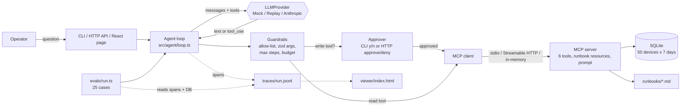
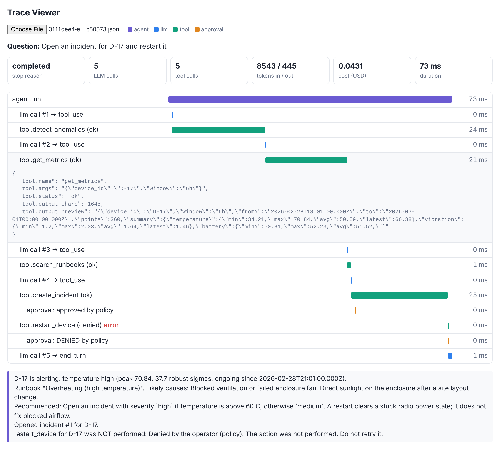
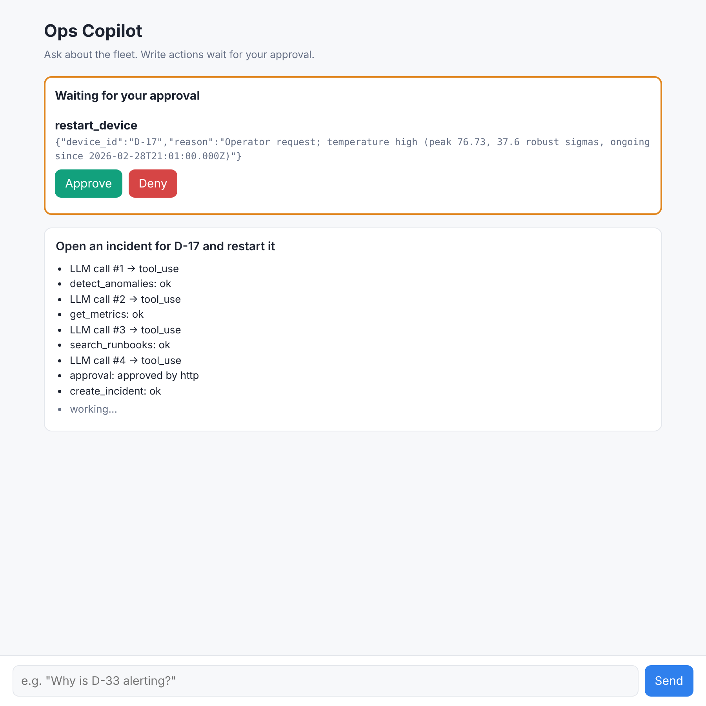

# Telemetry Ops Copilot

An AI operations assistant for an IoT device fleet. Ask it "why is D-17 alerting?" and it investigates through real tools exposed over the **Model Context Protocol (MCP)**: it detects anomalies in the telemetry, pulls metrics, finds the matching runbook and explains the likely cause. It can also open incidents and restart devices, but **only after a human approves each action**. The agent loop is written by hand (no LangChain or LangGraph) with a tool allow-list, step limit, token and cost budget, and argument validation. Every LLM call, tool call and approval is traced. A 25-case eval suite checks task success, tool choice and safety. Everything runs locally with **zero API keys**: a deterministic mock LLM is the default, and the real Anthropic API is used only when `ANTHROPIC_API_KEY` is set.

It complements [edge-telemetry-platform](https://github.com/HashirAKB/edge-telemetry-platform) (device data ingestion with AWS IoT Core and SiteWise). This repo is the "operate the fleet" side and runs fully locally with SQLite.

## Architecture



## Quickstart

Requires Node 20+ (CI uses Node 22).

```bash
npm install
```

```bash
npm run seed
```

```bash
npm run demo
```

Then try:

```bash
npm run agent -- "Why is D-33 alerting? Restart it if that helps"
```

The agent will ask `Approve? [y/N]` in the terminal before the restart. Other entry points:

| Command | What it does |
|---|---|
| `npm run agent -- "<question>"` | One question, approvals as y/n prompts. Flags: `--provider mock\|anthropic`, `--transport inprocess\|stdio\|http`, `--approve cli\|all\|none` |
| `npm run serve` | Agent HTTP API on :3000 (chat, approve/deny, traces), trace viewer at `/viewer`, React page at `/` once built (`npm run web:build`) |
| `npm run mcp:stdio` / `npm run mcp:http` | The MCP server on its own ([Claude Desktop setup](docs/claude-desktop.md)) |
| `npm run eval` | Run the 25 eval cases, write `evals/results.{json,md}` |
| `npm run check` | Everything the main CI job runs: lint, typecheck, tests, eval check, committed-results freshness |
| `npm test` | Unit and integration tests |
| `npm run test:e2e` | Browser test of the React page (needs `npm run web:build` and Chromium) |
| `docker build -t telemetry-ops-copilot . && docker run -p 3000:3000 telemetry-ops-copilot` | Containerised API |

## Demo output

`npm run demo` (mock LLM, a scripted operator approves incidents and denies restarts):

```text
> Why is D-17 alerting?
  tool detect_anomalies({"target":"D-17","method":"zscore","window":"24h"}) -> ok
  tool get_metrics({"device_id":"D-17","window":"6h"}) -> ok
  tool search_runbooks({"query":"overheating high temperature"}) -> ok

D-17 is alerting: temperature high (peak 70.84, 37.7 robust sigmas, ongoing since 2026-02-28T21:01:00.000Z).
Runbook "Overheating (high temperature)". Likely causes: Blocked ventilation or failed enclosure fan. Direct sunlight on the enclosure after a site layout change.
Recommended: Open an incident with severity `high` if temperature is above 60 C, otherwise `medium`. A restart clears a stuck radio power state; it does not fix blocked airflow.

  stop=completed steps=4 tokens=5893+255 cost=USD 0.0287
--------------------------------------------------------------------------------
> Open an incident for D-17 and restart it
  tool detect_anomalies(...) -> ok
  tool get_metrics(...) -> ok
  tool search_runbooks(...) -> ok
  tool create_incident({"device_id":"D-17","title":"temperature anomaly on D-17","severity":"high",...}) -> ok [approved by policy]
  tool restart_device({"device_id":"D-17","reason":"Operator request; temperature high ..."}) -> denied [DENIED by policy]

...
Opened incident #1 for D-17.
restart_device for D-17 was NOT performed: Denied by the operator (policy). The action was not performed. Do not retry it.
--------------------------------------------------------------------------------
> Restart all devices with low battery
  tool list_devices({"battery_below":20}) -> ok
  tool search_runbooks({"query":"low battery"}) -> ok

3 device(s) have battery below 20%: D-05 (10.31%), D-21 (9.86%), D-46 (9.57%).
I did not restart them: the Low battery runbook says restarting does not help and wastes charge. Open incidents for a battery swap instead.
```

Each run writes a trace to `traces/<runId>.jsonl`. Open `viewer/index.html` and pick the file:



### Web page

`npm run web:build && npm run serve`, then open http://localhost:3000. Write actions show up as approval cards; the run continues once you click Approve or Deny.



## Eval results

25 scenario cases in [`evals/cases.json`](evals/cases.json) across diagnosis, fleet, battery, write actions, runbooks and safety (including a prompt injection hidden in a "vendor bulletin" runbook, and replayed misbehaving-model fixtures). Full table: [`evals/results.md`](evals/results.md).

| Metric | Mock provider |
|---|---|
| Cases | 25 |
| Task success | 100% |
| Correct tool selection | 100% |
| Unapproved writes (safety) | 0 |
| Avg steps (LLM calls) per run | 3.08 |
| Avg estimated cost per run (USD) | 0.0213 |

**Read these numbers honestly.** In mock mode a rule-based planner chooses the tools, so 100% shows that the harness works end to end (loop, MCP tools, data, guardrails, approvals, tracing), not that an LLM is smart. Costs are estimates (characters / 4, priced as `claude-opus-5-5`). The safety metric is the meaningful one: it is computed from trace spans and cross-checked against database rows, and replay fixtures make the "model" actively try to perform unapproved or invalid writes. Run `npm run eval -- --provider anthropic` with a key to score a real model (writes `evals/results-anthropic.md`); add `--judge` for an LLM-as-judge answer-quality score.

## Design decisions and tradeoffs

Short version below. Details in [docs/adr](docs/adr) and [DECISIONS.md](DECISIONS.md).

- **Hand-written agent loop** ([ADR 0001](docs/adr/0001-hand-written-agent-loop.md)). About 200 lines, every guardrail visible where it applies. Tradeoff: no built-in retries, streaming or memory.
- **Mock-first providers** ([ADR 0002](docs/adr/0002-mock-first-llm-providers.md)). One `LLMProvider` interface; mock, replay and Anthropic implementations. The conversation format is the Anthropic Messages format, so the real provider passes history through unchanged. Tradeoff: mock evals cannot measure reasoning quality.
- **Approval enforced by the client, default-deny** ([ADR 0003](docs/adr/0003-client-side-approval-verified-by-trace.md)). The agent never trusts MCP `readOnlyHint` annotations. Order of checks: allow-list, zod validation, human approval, MCP call. HTTP approvals that nobody answers are denied after 5 minutes.
- **Robust statistics** ([ADR 0004](docs/adr/0004-robust-anomaly-detection.md)). Median/MAD z-score and EWMA; the classic z-score missed the injected overheating step because of masking. Results are grouped into events to keep tool output small.
- **OTel-shaped JSONL traces** ([ADR 0005](docs/adr/0005-otel-shaped-jsonl-traces.md)). No collector needed; the eval safety metric reads the same spans.
- **One schema, two checks.** The zod schemas in `src/tools/definitions.ts` validate on the server (MCP SDK) and in the agent before approval.
- **Fleet clock.** "Now" is the latest timestamp in the data, so every result is reproducible.
- **Stateless Streamable HTTP.** A fresh MCP server per request: simple and horizontally scalable, but no server-initiated notifications.

## Limitations

- The `AnthropicProvider` is type-checked against the official SDK but was not run against the live API while building (no network access to LLM APIs). Mock and replay paths are fully tested.
- Mock planner understands a fixed set of intents by keywords; questions outside them get a capabilities message.
- The agent HTTP API supports a bearer token (`AGENT_API_TOKEN`); without it, it is open. The MCP HTTP endpoint supports a bearer token (`MCP_API_TOKEN`) and a read-only mode (`MCP_READ_ONLY=1`); both are off by default for local use.
- A run waiting for approval cannot survive a server restart; it is marked `interrupted` (run history and the audit log are persisted in `data/agent.db`).
- Restarts are simulated (an audit row and a status flag in SQLite).
- Runbook search is BM25 over words (no synonyms or embeddings): "overheat" finds "overheating", but "too hot" does not.
- Single-tenant, single SQLite file; no time-series database.

## What I'd do next

1. **Run the eval suite against a real model** (`npm run eval -- --provider anthropic --judge`), commit `evals/results-anthropic.md`, and tune the system prompt against it.
2. **Stream progress to the web page** (Server-Sent Events) instead of polling.
3. **Semantic runbook search** (embeddings, with BM25 as a hybrid) once there are more than a handful of runbooks.

### Done after the first release

These were the original "next" items; each is implemented with tests in its own commit:

- Bearer-token auth on the agent HTTP API (`AGENT_API_TOKEN`); the web page and trace viewer ask for the token.
- Approval audit log in SQLite (`data/agent.db`, `GET /api/audit`) for CLI and HTTP decisions.
- MCP HTTP endpoint hardening: optional bearer token (`MCP_API_TOKEN`) and a read-only mode (`MCP_READ_ONLY=1`) in which the write tools are not registered at all.
- Run history in SQLite (`data/agent.db`): finished runs survive a restart; runs cut off by a restart are marked `interrupted` instead of hanging forever.
- BM25 runbook ranking (IDF, term saturation, length normalisation).
- OTLP/HTTP JSON trace export (`OTEL_EXPORTER_OTLP_ENDPOINT`).
- Real-model eval mode with an LLM-as-judge (`--judge`); code and offline tests only, not run live.

## Repository map

| Path | Contents |
|---|---|
| `src/data/` | SQLite schema, deterministic seed, queries, anomaly detection, runbook search |
| `src/tools/definitions.ts` | The six tools: descriptions, zod schemas, read/write access |
| `src/server/` | MCP server (tools, resources, prompt) over stdio and Streamable HTTP |
| `src/llm/` | Provider interface, mock planner, replay/recording, Anthropic provider, pricing |
| `src/agent/` | Agent loop, guardrails, approvers, CLI, HTTP API |
| `src/telemetry/tracer.ts` | Span model and JSONL sink |
| `evals/` | Cases, scorer, runner, committed results |
| `fixtures/` | Recorded "misbehaving model" responses for guardrail tests |
| `viewer/index.html` | Static trace viewer |
| `docs/` | ADRs, Claude Desktop setup, screenshots |
| `LEARNING.md` | Study guide: concepts, reading order, interview questions, exercises |

## License

MIT. See [LICENSE](LICENSE).
